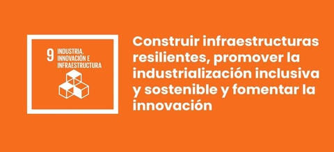
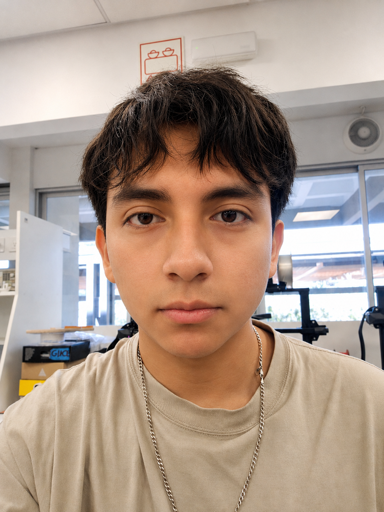

# MINEGUARD — Equipo 05

### Dispositivo portátil para el monitoreo y alerta de condiciones ambientales en entornos mineros

**Fundamentos de Diseño 2026-2 · Ingeniería Informática e Ingeniería Industrial**  
**Universidad Peruana Cayetano Heredia · Facultad de Ciencias e Ingeniería**

## Sobre el proyecto

Somos el Equipo 05 y desarrollamos **MINEGUARD**, un prototipo portátil que integra la captación de señales asociadas a metano (CH₄) y monóxido de carbono (CO), lecturas de temperatura y humedad relativa, y detección de vibración. Su propósito es presentar la información de forma comprensible y emitir avisos visuales y sonoros durante ensayos controlados.

El proyecto reúne adquisición de señales, procesamiento, control, interfaz, alimentación y soporte mecánico. La transmisión inalámbrica y GSM complementa la presentación y el aviso local cuando existe un enlace o cobertura disponible.

[Consultar el informe técnico del proyecto](https://docs.google.com/document/d/1l9tRPn6Qk1oJSVGrcFGP6qKJbPwjnJntbNSGrZ6dly4/edit?tab=t.0)

## Problemática

Las labores de minería subterránea presentan riesgos ambientales relacionados con la presencia de gases, la ventilación y otras condiciones del entorno. Los antecedentes sobre enfermedades ocupacionales del sector minero peruano y el marco de seguridad y salud ocupacional muestran la importancia de identificar y controlar estos factores. [1](#ref-1), [2](#ref-2) Las tecnologías de sensores y comunicación aportan alternativas para reunir información de distintas variables, aunque su desempeño depende de las condiciones de instalación y uso. [3](#ref-3)

El informe considera **dos grupos de usuarios**. Para los pequeños mineros, la necesidad de diseño es reunir lecturas seleccionadas y avisos locales en un equipo portátil. Para los pobladores cercanos, se busca explorar una presentación de información ambiental que resulte sencilla de comprender. Los antecedentes sobre monitoreo participativo y experiencias comunitarias en Perú y Chile respaldan la relevancia de la participación y la interpretación de los datos. [4](#ref-4), [5](#ref-5)

El caso de las estaciones de calidad del aire anunciadas por el OEFA en Espinar también muestra la importancia de acercar información ambiental a las comunidades. [6](#ref-6) Sin embargo, esas estaciones y MINEGUARD tienen alcances distintos: los parámetros del prototipo no permiten caracterizar toda la calidad del aire ni equivalen a los de una estación oficial, que puede incluir partículas y otros contaminantes. [7](#ref-7)

### Pregunta de diseño

**¿Cómo podríamos facilitar que los pequeños mineros y pobladores cercanos comprendan las lecturas de las variables de su entorno y reconozcan los avisos de manera sencilla?**

## Alcance del prototipo

| Variable o función | Alcance planteado |
|---|---|
| CH₄ y CO | Captar y presentar señales de los sensores en ensayos; no expresarlas como concentraciones verificadas en ppm. |
| Temperatura y humedad relativa | Adquirir y mostrar las lecturas obtenidas. |
| Vibración | Detectar la respuesta del sensor a estímulos de ensayo; no diagnosticar la estabilidad de una mina. |
| Interfaz y avisos | Mostrar lecturas y estado del equipo; activar indicaciones visuales y sonoras según criterios de prueba programados. |
| Comunicación | Transmitir lecturas y estado cuando exista enlace; mantener el aviso básico de forma local. |

Las pruebas se enfocan en la integración del dispositivo, la respuesta de los sensores, la presentación de las lecturas y el funcionamiento de los avisos. Los criterios de ensayo no son límites normativos de exposición. La literatura sobre sensores de bajo costo destaca la necesidad de calibración y validación para interpretar sus resultados. [8](#ref-8)

MINEGUARD se plantea como una herramienta complementaria de prototipado. No certifica condiciones seguras de trabajo, no identifica el origen de una alteración ambiental, no mide material particulado ni metales y no sustituye instrumentos profesionales, evaluaciones especializadas o sistemas oficiales de vigilancia.

## Relación con los Objetivos de Desarrollo Sostenible

| ODS | Relación con el proyecto |
|---|---|
| **ODS 3 — Salud y bienestar (principal)** | Orienta el estudio de condiciones ambientales y la comprensión de avisos, desde el alcance de un prototipo académico. |
| **ODS 8 — Trabajo decente y crecimiento económico** | Vincula la necesidad de información con el interés por entornos de trabajo seguros. |
| **ODS 9 — Industria, innovación e infraestructura** | Promueve la integración y evaluación de sensores, electrónica, comunicación y fabricación digital. |

  
  
  

## Contenido del repositorio

- [Documentación del curso, entregables y talleres](Fundamentos_de_Diseño/README.md).
- [Archivos del proyecto y módulos electrónico, mecánico y de software](Proyecto/README.md).
- [Imágenes y recursos del equipo](Recursos/Imágenes).

El informe enlazado desarrolla el estado de la tecnología, la lista de exigencias, la caja negra, la estructura de funciones, las matrices morfológicas y los tres conceptos de solución.

---

## 📸 Fotografía del Equipo  

  <em>Figura 1. Fotografía del equipo 05</em>

---

## 👥 Integrantes del Equipo  

| Foto | Nombre | Rol | Intereses | Correo institucional |
|------|--------|-----|-----------|----------------------|
|  | Richard Aaron Soriano Cordova | Líder del equipo | Innovación social, sostenibilidad | richard.soriano@upch.pe |
|  | Jose Gonzalo Saldaña Rodriguez | Responsable de investigación | Gestión ambiental, desarrollo comunitario | jose.saldana@upch.pe |
|  | Willian Chuyma Vargas | Diseñador/a | Diseño de prototipos, creatividad aplicada | willian.chuyma@upch.pe |
|  | Amador Antonio Jara Castañeda | Encargado/a de documentación | Comunicación científica, redacción técnica | amador.jara@upch.pe |
|  | Jose Fernando Chavez Lozano | Programador/a - Modelador/a | Programación, análisis de datos, simulación | jose.chavez@upch.pe |

---

## Referencias bibliográficas

Referencias de esta presentación general en formato Vancouver, elaboradas a partir de los registros de la biblioteca compartida **FdD05** de Zotero y cotejadas con el informe. La numeración corresponde a este README. La bibliografía completa del proyecto se encuentra en el [informe técnico](https://docs.google.com/document/d/1l9tRPn6Qk1oJSVGrcFGP6qKJbPwjnJntbNSGrZ6dly4/edit?tab=t.0).

1. Aquino-Canchari CR, Huamán-Castillón KM, Jiménez-Mozo F. Enfermedades ocupacionales en minería en el Perú, 2011-2020. Revista de la Asociación Española de Especialistas en Medicina del Trabajo. 2022;31(3):275-82. Disponible en: [Consultar fuente](https://scielo.isciii.es/pdf/medtra/v31n3/1132-6255-medtra-31-03-275.pdf)

2. Ministerio de Energía y Minas. Reglamento de Seguridad y Salud Ocupacional en Minería. Ed. 2026 [Internet]. [citado 2 de septiembre de 2026]. Disponible en: [Consultar fuente](https://www.gob.pe/institucion/minem/informes-publicaciones/5631689-reglamento-de-seguridad-y-salud-ocupacional-en-mineria-ed-2026)

3. Naik AS, Reddy SK, Mandela GR. A Systematic Review on Implementation of Internet-of-Things-Based System in Underground Mines to Monitor Environmental Parameters. J Inst Eng India Ser D. 1 de agosto de 2024;105(2):1273-89. doi: [10.1007/s40033-023-00541-3](https://doi.org/10.1007/s40033-023-00541-3)

4. Ministerio de Energía y Minas. Guía para la implementación de Comités de Monitoreo y Vigilancia Ambiental Participativo [Internet]. 2012 [citado 6 de octubre de 2026]. Disponible en: [Consultar fuente](https://www.gob.pe/institucion/minem/informes-publicaciones/4721061-guia-para-la-implementacion-de-comites-de-monitoreo-y-vigilancia-ambiental-participativo)

5. Damonte G, Godfrid J, Lopez AP. Adopting Technology and Community Empowerment: Environmental Community-based Monitoring in Peru and Chile. Human Ecology. 27 de mayo de 2026;54(3):39. doi: [10.1007/s10745-026-00697-y](https://doi.org/10.1007/s10745-026-00697-y)

6. Organismo de Evaluación y Fiscalización Ambiental. OEFA implementa dos nuevas estaciones que vigilarán la calidad del aire en Espinar [Internet]. Organismo de Evaluación y Fiscalización Ambiental; 2026 [citado 11 de noviembre de 2026]. Disponible en: [Consultar fuente](https://www.gob.pe/institucion/oefa/noticias/1419936-oefa-implementa-dos-nuevas-estaciones-que-vigilaran-la-calidad-del-aire-en-espinar)

7. Organismo de Evaluación y Fiscalización Ambiental. OEFA contará con 43 estaciones de monitoreo de calidad de aire para fortalecer vigilancia ambiental [Internet]. Organismo de Evaluación y Fiscalización Ambiental; 2024 [citado 11 de noviembre de 2026]. Disponible en: [Consultar fuente](https://www.gob.pe/institucion/oefa/noticias/1033573-oefa-contara-con-43-estaciones-de-monitoreo-de-calidad-de-aire-para-fortalecer-vigilancia-ambiental)

8. Bagkis E, Hassani A, Schneider P, DeSouza P, Shetty S, Kassandros T, et al. Evolving trends in application of low-cost air quality sensor networks: challenges and future directions. npj Clim Atmos Sci. 2 de octubre de 2025;8(1):335. doi: [10.1038/s41612-025-01216-4](https://doi.org/10.1038/s41612-025-01216-4)

[Descargar las referencias de esta presentación en BibTeX](Recursos/Referencias/references.bib).

