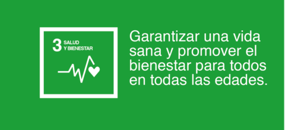
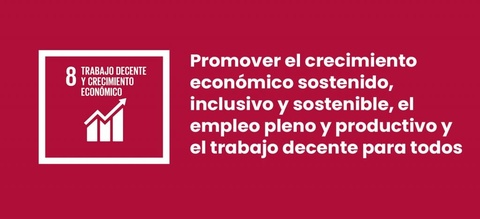
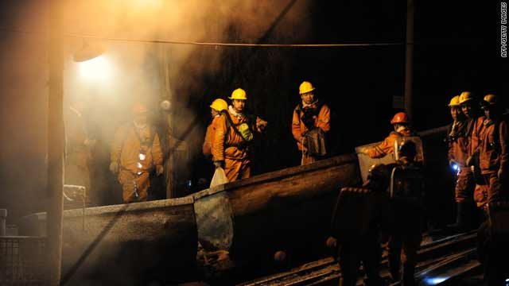
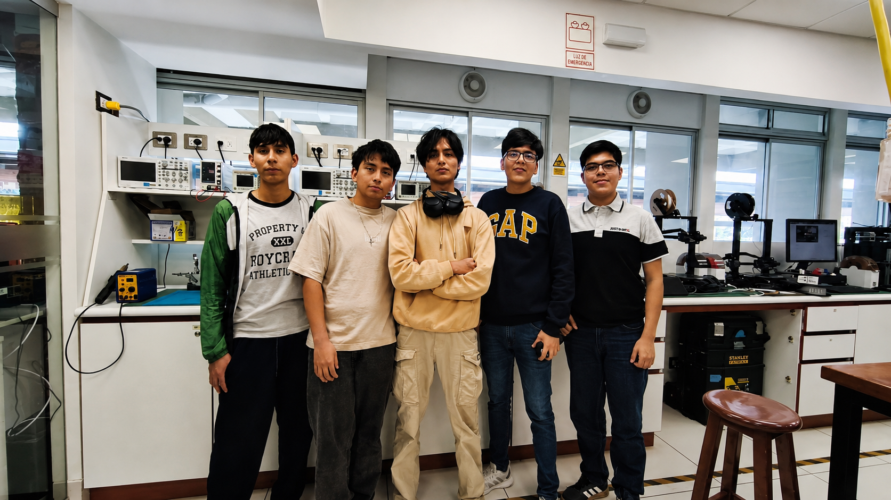

# Equipo 05 - Fundamentos de Diseño
### Carrera de Ingeniería Informática / Industrial  
**Universidad Peruana Cayetano Heredia**

---

## 🌍 Descripción del Equipo 
Somos el **Equipo 05** del curso **Fundamentos de Diseño 2026-2**, conformado por estudiantes de la carrera de Ingeniería Informática e Ingeniería Industrial.  
Nuestro objetivo es aplicar la metodología de diseño para analizar problemáticas actuales y plantear, posteriormente, soluciones innovadoras que contribuyan al bienestar social, la seguridad, la sostenibilidad y el desarrollo tecnológico.  

Hemos decidido enfocar nuestro trabajo en tres **Objetivos de Desarrollo Sostenible (ODS)** que consideramos estrechamente conectados entre sí: la salud y seguridad de las personas están relacionadas con las condiciones laborales, la infraestructura y la tecnología disponibles.

### 🏥 ODS 3: Salud y Bienestar - ODS PRINCIPAL
Buscamos aportar a la mejora de la salud y el bienestar de las personas. Nos interesan especialmente los aspectos relacionados con la prevención de riesgos y la protección de la salud, especialmente en contextos donde existen condiciones de trabajo de mayor riesgo.

**Meta 3.9:** Reducir sustancialmente el número de muertes y enfermedades producidas por productos químicos peligrosos y por la contaminación del aire, el agua y el suelo.

### 💼 ODS 8: Trabajo Decente y Crecimiento Económico
Buscamos contribuir a la promoción de condiciones laborales seguras y adecuadas para los trabajadores. Consideramos especialmente importante la prevención de riesgos y la protección de la seguridad y salud de las personas en actividades laborales de alto riesgo.

**Meta 8.8:** Proteger los derechos laborales y promover entornos de trabajo seguros y protegidos para todos los trabajadores.

### 🏭 ODS 9: Industria, Innovación e Infraestructura
Como estudiantes de ingeniería, este objetivo es el eje de nuestra formación. Nos interesa analizar cómo la infraestructura y los procesos industriales pueden influir en la seguridad, eficiencia y sostenibilidad de las actividades productivas, especialmente en contextos donde existen condiciones de trabajo de mayor riesgo.

**Meta 9.4:** Modernizar la infraestructura y reconvertir las industrias para que sean sostenibles, utilizando los recursos con mayor eficiencia y promoviendo tecnologías y procesos más limpios.

### ⚠️ Nuestra problemática a abordar

Nuestro equipo abordará la seguridad y salud ocupacional de los trabajadores en actividades de minería subterránea en el Perú, delimitando nuestra problemática a la exposición a condiciones ambientales potencialmente peligrosas en el interior de las labores mineras, particularmente aquellas relacionadas con la calidad del aire, la presencia de gases y material particulado.

La relevancia de esta problemática se evidencia en las estadísticas de enfermedades ocupacionales del sector minero peruano. Durante el periodo 2011-2020 se registraron 37 899 casos de enfermedades ocupacionales, de los cuales 35 891 (90,74 %) correspondieron a hipoacusia y 1 875 (4,94 %) a neumoconiosis. Asimismo, los agentes físicos representaron 38 181 casos (95,09 %) y los agentes químicos 1 954 casos (4,87 %) (Aquino-Canchari et al., 2022).

La problemática también comprende riesgos agudos asociados a la atmósfera de las labores subterráneas. El Reglamento de Seguridad y Salud Ocupacional en Minería establece medidas específicas para las labores donde existe liberación de gases, incluyendo la ventilación forzada para mantener sus concentraciones por debajo de los límites de exposición ocupacional. Asimismo, contempla medidas de protección frente al monóxido de carbono en determinadas operaciones subterráneas (Ministerio de Energía y Minas [MINEM], 2026).

Esta situación continúa siendo relevante desde el punto de vista de la seguridad minera. En la mediana y gran minería, Osinergmin reportó que hasta junio de 2026 se habían registrado 13 accidentes mortales con 15 víctimas mortales, aunque el índice de accidentabilidad mantiene una tendencia a la baja (Osinergmin, 2026).

Por ello, nos enfocaremos en comprender cómo las condiciones ambientales presentes en las labores de minería subterránea pueden afectar la seguridad, salud y bienestar de los trabajadores, considerando particularmente la calidad del aire, la exposición a gases y material particulado, así como las condiciones de ventilación. En esta etapa no planteamos una solución específica, sino que buscamos caracterizar y comprender la problemática que abordaremos durante el curso.

   
  
---

## 📸 Fotografía del Equipo  

  <em>Figura 1. Fotografía del equipo 05</em>

---

## 👥 Integrantes del Equipo  

| Foto | Nombre | Rol | Intereses | Correo institucional |
|------|--------|-----|-----------|----------------------|
|  | Richard Aaron Soriano Cordova | Líder del equipo | Innovación social, sostenibilidad | richard.soriano@upch.pe |
|  | Jose Gonzalo Saldaña Rodriguez | Responsable de investigación | Gestión ambiental, desarrollo comunitario | jose.saldana@upch.pe |
|  | Willian Chuyma Vargas | Diseñador/a | Diseño de prototipos, creatividad aplicada | willian.chuyma@upch.pe |
|  | Amador Antonio Jara Castañeda | Encargado/a de documentación | Comunicación científica, redacción técnica | amador.jara@upch.pe |
|  | Jose Fernando Chavez Lozano | Programador/a - Modelador/a | Programación, análisis de datos, simulación | jose.chavez@upch.pe | 

---

## 📌 Resumen Final   
Este README presenta quiénes somos, qué nos motiva y los ODS en los que queremos enfocar nuestro trabajo durante el curso. Para nosotros, la **Salud y bienestar (ODS 3)**, el **Trabajo Decente y Crecimiento Económico (ODS 8)** y la **Industria, innovación e infraestructura (ODS 9)** están estrechamente relacionados. Consideramos que, desde la ingeniería, podemos analizar problemáticas reales y, posteriormente, plantear soluciones que mejoren la calidad de vida de las personas y, al mismo tiempo, contribuyan al cuidado y sostenibilidad de nuestro entorno.

### 📚 Referencias bibliográficas (README)

Aquino-Canchari, C. R., Huamán-Castillón, K. M., & Jiménez-Mozo, F. (2022). Enfermedades ocupacionales en minería en el Perú, 2011-2020. Revista de la Asociación Española de Especialistas en Medicina del Trabajo, 31(3), 275–282. https://scielo.isciii.es/scielo.php?script=sci_arttext&pid=S3020-11602022000300004

Ministerio de Energía y Minas. (2026). Reglamento de Seguridad y Salud Ocupacional en Minería (Ed. 2026). Gobierno del Perú. https://www.gob.pe/institucion/minem/informes-publicaciones/5631689-reglamento-de-seguridad-y-salud-ocupacional-en-mineria-ed-2026

Organismo Supervisor de la Inversión en Energía y Minería. (2026). Boletín estadístico de accidentes mortales en la mediana y gran minería. https://rendiciondecuentas.osinergmin.gob.pe/mineria-boletin-accidentes-mortales

Pacto Mundial de Naciones Unidas. (s. f.). ODS: Objetivos de Desarrollo Sostenible. https://www.pactomundial.org/que-puedes-hacer-tu/ods/

### 📚 Referencias bibliográficas (PROYECTO)

1. Aquino-Canchari CR, Huamán-Castillón KM, Jiménez-Mozo F. Enfermedades ocupacionales en minería en el Perú, 2011-2020. Revista de la Asociación Española de Especialistas en Medicina del Trabajo [Internet]. 2022 [citado 2 de septiembre de 2026];31(3):275-82. Disponible en: https://scielo.isciii.es/pdf/medtra/v31n3/1132-6255-medtra-31-03-275.pdf
2.	Paluchamy B, Mishra DP, Panigrahi DC. Airborne respirable dust in fully mechanised underground metalliferous mines – Generation, health impacts and control measures for cleaner production. Journal of Cleaner Production. 10 de mayo de 2021;296:126524. doi:10.1016/j.jclepro.2021.126524
3.	Cárdenas Gonzáles D. Mejoramiento del sistema de ventilación de minas para suministrar aire limpio a las labores subterráneas [Tesis de grado] [Internet]. Universidad Nacional de Ingeniería; 2020 [citado 2 de septiembre de 2026]. Disponible en: https://repositorio.uni.edu.pe/handle/20.500.14076/21710
4.	Quispe Rodriguez I, Alarcón Medina EC. EMISIÓN GAS DE ESTRATO Y EFECTOS SOBRE LA SALUD DE TRABAJADORES EN OPERACIONES MINERAS-MINA CATALINA HUANCA, 2023. Investigación. 30 de junio de 2024;31(1):3. doi:10.51440/unsch.revista investigación.31.1.2024.699
5.	Ministerio de Energía y Minas. Reglamento de Seguridad y Salud Ocupacional en Minería. Ed. 2026 [Internet]. [citado 2 de septiembre de 2026]. Disponible en: https://www.gob.pe/institucion/minem/informes-publicaciones/5631689-reglamento-de-seguridad-y-salud-ocupacional-en-mineria-ed-2026
6.	Naik AS, Reddy SK, Mandela GR. A Systematic Review on Implementation of Internet-of-Things-Based System in Underground Mines to Monitor Environmental Parameters. J Inst Eng India Ser D. 1 de agosto de 2024;105(2):1273-89. doi:10.1007/s40033-023-00541-3
7.	Ministerio de Energía y Minas. Guía para la implementación de Comités de Monitoreo y Vigilancia Ambiental Participativo [Internet]. Ministerio de Energía y Minas; 2012 [citado 6 de octubre de 2026]. Disponible en: https://www.gob.pe/institucion/minem/informes-publicaciones/4721061-guia-para-la-implementacion-de-comites-de-monitoreo-y-vigilancia-ambiental-participativo
8.	Damonte G, Godfrid J, Lopez AP. Adopting Technology and Community Empowerment: Environmental Community-based Monitoring in Peru and Chile. Human Ecology. 27 de mayo de 2026;54(3):39. doi:10.1007/s10745-026-00697-y
9.	Organismo de Evaluación y Fiscalización Ambiental. OEFA implementa dos nuevas estaciones que vigilarán la calidad del aire en Espinar [Internet]. Lima: OEFA; 16 de julio de 2026 [citado 11 de noviembre de 2026]. Disponible en: https://www.gob.pe/institucion/oefa/noticias/1419936-oefa-implementa-dos-nuevas-estaciones-que-vigilaran-la-calidad-del-aire-en-espinar
10.	Organismo de Evaluación y Fiscalización Ambiental. OEFA contará con 43 estaciones de monitoreo de calidad de aire para fortalecer vigilancia ambiental [Internet]. Lima: OEFA; 3 de octubre de 2024 [citado 11 de noviembre de 2026]. Disponible en: https://www.gob.pe/institucion/oefa/noticias/1033573-oefa-contara-con-43-estaciones-de-monitoreo-de-calidad-de-aire-para-fortalecer-vigilancia-ambiental
11.	Bagkis E, Hassani A, Schneider P, DeSouza P, Shetty S, Kassandros T, et al. Evolving trends in application of low-cost air quality sensor networks: challenges and future directions. npj Clim Atmos Sci. 2 de octubre de 2025;8(1):335. doi:10.1038/s41612-025-01216-4
12.	Maestro Digital Mine. Vigilante AQSTM - air quality station | Maestro Digital Mine [Internet]. [citado 2 de septiembre de 2026]. Disponible en: https://www.maestrodigitalmine.com/products/vigilante-aqs-air-quality-station
13.	Trolex. Supporting underground health and safety in real time – Trolex [Internet]. [citado 2 de septiembre de 2026]. Disponible en: https://trolex.com/supporting-underground-health-and-safety-in-real-time/
14.	CONSPEC Controls Inc. Mining & Tunneling - Monitoring & Ventilation Control Equipment | CONSPEC Controls Inc [Internet]. 21 de junio de 2021 [citado 2 de septiembre de 2026]. Disponible en: https://conspec-controls.com/industries/mining-tunneling/
15.	王作舟, 杨林雪, 于涛. Underground coal mine safety electronic monitoring device [Internet]. CN220667645U, 2024 [citado 2 de septiembre de 2026]. Disponible en: https://patents.google.com/patent/CN220667645U/en
16.	Albinger RE, Lawler CT, Michaud T, Berube M, Dunkin B, Hakins DW, et al. Gas Monitor, System and Method [Internet]. US20150145685A1, 2015 [citado 2 de septiembre de 2026]. Disponible en: https://patents.google.com/patent/US20150145685A1/en
17.	梁自荣. Portable wireless multi-parameter gas detection and personnel search and rescue instrument [Internet]. CN203489910U, 2014 [citado 11 de noviembre de 2026]. Disponible en: https://patents.google.com/patent/CN203489910U/en
18.	Tajima S, Takei Y. Portable gas detector [Internet]. US7178381B2, 2007 [citado 6 de octubre de 2026]. Disponible en: https://patents.google.com/patent/US7178381B2/en
19.	Johnson D, Clark N, Barr A, Cappellini B. Methane watchdog system, a cost effective approach to longwall methane monitoring and control [Internet]. US12031888B2, 2024 [citado 6 de octubre de 2026]. Disponible en: https://patents.google.com/patent/US12031888B2/en
20.	EVJU JK, Fillmore RL. Systems and methods for membrane  blockage detection in gas detectors [Internet]. EP4170318B1, 2026 [citado 6 de octubre de 2026]. Disponible en: https://patents.google.com/patent/EP4170318B1/en
21.	Hassan HZ ul, Wang A, Mohi-ud-din G. A wireless sensor network for coal mine safety powered by modified localization algorithm. Heliyon. 15 de enero de 2025;11(1):e41262. doi:10.1016/j.heliyon.2024.e41262
22.	Zhang Y, Yang W, Han D, Kim YI. An Integrated Environment Monitoring System for Underground Coal Mines—Wireless Sensor Network Subsystem with Multi-Parameter Monitoring. Sensors. julio de 2014;14(7):13149-70. doi:10.3390/s140713149
23.	Bashu B, Srikanth B. Artificial Intelligence Enabled Wireless Sensor Network for Underground Mines Safety: A Systematic Review. Journal of The Institution of Engineers (India): Series D. 17 de diciembre de 2025. doi:10.1007/s40033-025-00971-1
24.	Asencio Puma F. Implementación de un sistema de monitoreo ambiental con sensores inteligentes para mejorar la seguridad en pequeña minería subterránea, Trujillo 2024 [Tesis de grado] [Internet]. Universidad Católica de Santa María; 2026 [citado 2 de septiembre de 2026]. Disponible en: https://repositorio.ucsm.edu.pe/items/cbbd5c57-d136-44a1-b833-32aa96c7719c
25.	Useche Galindo LJ. Diseño de un sistema de supervisión y control de gases contaminantes para minas subterráneas [Trabajo de grado] [Internet]. Universidad Distrital Francisco José de Caldas; 2025 [citado 2 de septiembre de 2026]. Disponible en: https://repository.udistrital.edu.co/handle/11349/100323
26.	Pozo Bulnes CA, Ari Uturonco JAN. Modelamiento y diagnóstico del circuito actual de ventilación en una mina subterránea y propuesta de mejora [Tesis de grado] [Internet]. Pontificia Universidad Católica del Perú; 2023 [citado 2 de septiembre de 2026]. Disponible en: https://tesis.pucp.edu.pe/handle/20.500.12404/25925
27.	Hanwei Electronics. Technical Data MQ-4 Gas Sensor [Ficha técnica] [Internet]. Hanwei Electronics; [citado 11 de noviembre de 2026]. Ficha técnica MQ-4. Disponible en: https://cdn.sparkfun.com/assets/e/f/c/7/d/MQ-4.pdf
28.	Hanwei Electronics Co., Ltd. Technical Data MQ-7 Gas Sensor [Ficha técnica] [Internet]. Hanwei Electronics Co., Ltd.; [citado 11 de noviembre de 2026]. Ficha técnica MQ-7. Disponible en: https://cdn.sparkfun.com/assets/b/b/b/3/4/MQ-7.pdf
29.	Aosong Electronics. DHT11 Humidity & Temperature Sensor [Internet]. Aosong Electronics; [citado 11 de noviembre de 2026]. Disponible en: https://www.mouser.com/datasheet/2/758/DHT11-Technical-Data-Sheet-Translated-Version-1143054.pdf
30.	Seeed Studio. Grove - Vibration Sensor (SW-420) [Internet]. [citado 11 de noviembre de 2026]. Disponible en: https://wiki.seeedstudio.com/Grove-Vibration_Sensor_SW-420/
31.	Arduino. UNO R3 [Internet]. [citado 6 de octubre de 2026]. Disponible en: https://docs.arduino.cc/hardware/uno-rev3/
32.	Hitachi, Ltd. HD44780U (LCD-II), (Dot Matrix Liquid Crystal Display Controller/Driver) [Internet]. Hitachi, Ltd.; septiembre de 1999 [citado 11 de noviembre de 2026]. Report ADE-207-272(Z). Disponible en: https://www.sparkfun.com/datasheets/LCD/HD44780.pdf
33.	Digi International Inc. XBee/XBee-PRO S2C Zigbee RF Module User Guide [Internet]. Digi International Inc.; julio de 2024 [citado 11 de noviembre de 2026]. Report 90002002 AP. Disponible en: https://www.digi.com/resources/documentation/digidocs/pdfs/90002002.pdf
34.	Texas Instruments. LM2596 SIMPLE SWITCHER Power Converter 150-kHz 3-A Step-Down Voltage Regulator [Internet]. Texas Instruments; marzo de 2023 [citado 11 de noviembre de 2026]. Report no.: SNVS124G. Disponible en: https://www.ti.com/lit/ds/symlink/lm2596.pdf
35.	SIMCom. SIM900 AT Commands Manual V1.11 [Internet]. SIMCom; enero de 2015 [citado 11 de noviembre de 2026]. Disponible en: https://simcom.ee/documents/SIM900/SIM900_AT%20Command%20Manual_V1.11.pdf
36.	SIMCom. SIM900 Hardware Design V2.05 [Internet]. SIMCom; agosto de 2013 [citado 11 de noviembre de 2026]. Disponible en: https://simcom.ee/documents/SIM900/SIM900_Hardware%20Design_V2.05.pdf
37.	Texas Instruments. L293x Quadruple Half-H Drivers [Ficha técnica] [Internet]. Texas Instruments; enero de 2016 [citado 11 de noviembre de 2026]. Ficha técnica no.: SLRS008D. Disponible en: https://www.ti.com/lit/ds/symlink/l293d.pdf
38.	Arduino. LiquidCrystal [Internet]. [citado 11 de noviembre de 2026]. Disponible en: https://docs.arduino.cc/libraries/liquidcrystal/
39.	Zhang H, Li B, Karimi M, Saydam S, Hassan M. Recent Advancements in IoT Implementation for Environmental, Safety, and Production Monitoring in Underground Mines. IEEE Internet of Things Journal. agosto de 2023;10(16):14507-26. doi:10.1109/JIOT.2023.3267828
